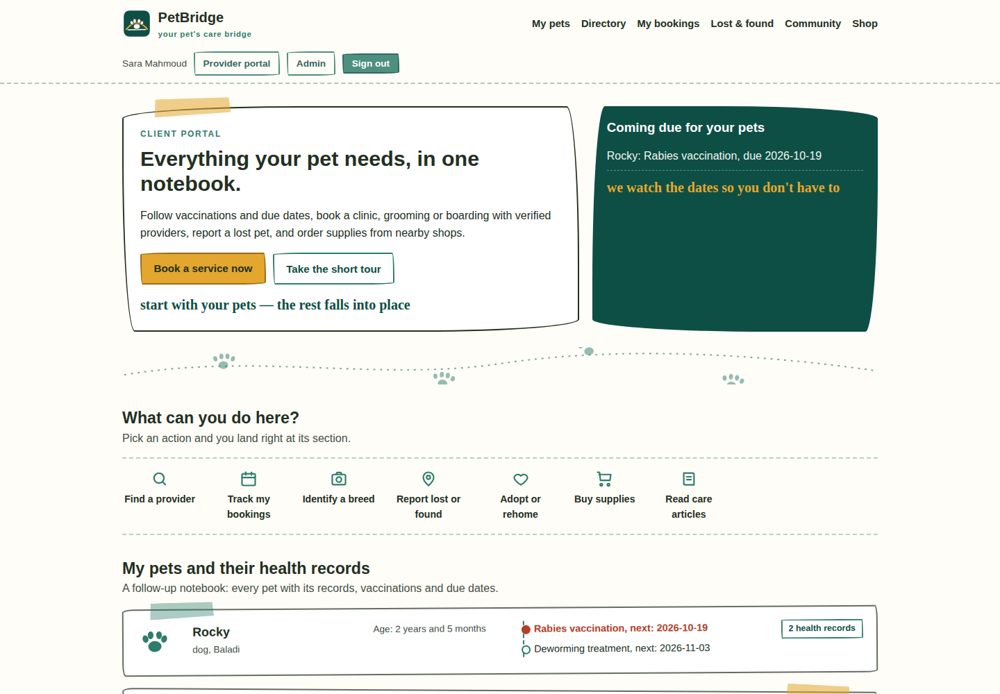

# PetBridge

PetBridge is a pet services platform for Egypt. A pet owner manages their pets' profiles and health records, finds approved providers and books them. A provider runs their business, bookings and earnings from one studio. The administration reviews providers, services and products, and oversees the community and the money from a third console.

The project is built as a product that can actually run, not a showcase page. Booking, commission, approval and settlement are core parts of the system from the first version. The design system — one brand in three portal identities — is documented in [DESIGN.md](DESIGN.md).

## The three systems

### Client
- A profile per pet with species, breed, birth date and a computed age
- Vaccination, medication and checkup records with due dates and overdue status
- A service directory across 8 categories and 35 services from the approved taxonomy, with city and category filters, search and reviews
- Booking from real availability slots opened by the provider, with booking status tracking and replies to proposed alternative times
- Lost and found board, adoption board, and a community with posts, comments and reports
- Educational articles and a products shop
- A breed identification tool from a photo, in a clearly labelled beta form

### Provider and shop
- Business registration with verification documents; the account waits for admin approval before it appears
- Services from the approved taxonomy with price, duration and delivery mode; every new or edited service waits for approval
- An availability calendar with a capacity per slot
- A booking inbox: accept, reject, propose an alternative time, complete
- Net earnings after the platform commission, documents, reviews, and shop products and orders

### Admin
- Live indicators: users, providers, bookings, orders, open reports and total commissions
- Approval queues for providers, services and products
- Community moderation: hide a post or warn its author; reports close automatically when resolved
- Account management with suspend and reactivate
- Oversight of every booking and its commission
- An audit log that cannot be edited or deleted, even from the database itself
- Graded admin roles: super admin, moderator, and support with narrower permissions

## How the money moves

1. The client books a service at its listed directory price.
2. The server computes the total and the platform commission rate at booking time and pins both on the booking itself, so they never change if the rate changes later.
3. The default rate is 12%, and the super admin can change it from the admin settings.
4. When a booking completes, the same three numbers appear in the client, provider and admin views: total, commission and provider net.
5. Shop products carry a 10% platform commission with the same pin-at-order logic.

Current payment is a labelled simulation, named as such in the interface and the database. Connecting a real Egyptian payment gateway is a launch step that needs a contract and business credentials; its place in the code is the current payment layer.

## Running it locally

Requirements: Python 3.11 or newer only. No external packages, no build step.

```bash
cd backend
python3 app.py
```

Then open:

- Client: http://127.0.0.1:8765/
- Sign in and registration: http://127.0.0.1:8765/login
- Provider: http://127.0.0.1:8765/provider
- Admin: http://127.0.0.1:8765/admin

The first run creates a SQLite database at `backend/petbridge.db` and seeds it with fully fictional demo data. Change the database location or the port with the `PETBRIDGE_DB` and `PETBRIDGE_PORT` environment variables.

The web app is a PWA with a manifest and a service worker, so it installs on Android and iOS home screens from the browser. Native store apps are not part of this version.

## Demo accounts

| Role | Email | Password |
| --- | --- | --- |
| Super admin | admin@petbridge.local | Admin123! |
| Content and community moderator | mod@petbridge.local | Mod12345! |
| Support | support@petbridge.local | Support123! |
| Client | sara@petbridge.local | Sara123! |
| Client | omar@petbridge.local | Omar123! |
| Approved clinic | clinic@petbridge.local | Vet123! |
| Grooming salon | groom@petbridge.local | Groom123! |
| Trainer | train@petbridge.local | Train123! |
| Pet hotel | hotel@petbridge.local | Hotel123! |
| Supplies shop | shop@petbridge.local | Shop123! |
| Provider awaiting approval | pending@petbridge.local | Wait123! |

The pending account exists so you can try the admin approval queue exactly as it is, from the first run.

## Tests

```bash
python3 -m unittest discover -s tests -v
```

22 tests cover the approval gate end to end, commission math against direct SQL, vaccination overdue logic, booking states and alternative-time proposals, role isolation, SQL injection, audit log immutability, and the PWA files and pages.

## Honest limits of the current version

- Payment is a simulation. There is no real payment gateway yet.
- Breed identification is a local beta flow labelled Beta in the interface and its results, with no accuracy claims anywhere. Its place is reserved behind a single endpoint, ready for a real vision model at launch.
- File uploads in registration, documents and photos are metadata only; no binary files are stored yet.
- There is no interactive map, no native store apps, and no email or push notifications yet.
- This version is a single server on SQLite, suitable for a first launch in one or two cities and for proving the model; moving to a server database is a planned scaling step.

## Screenshots



The client portal: a returning owner, her pets, and what is due. The
other two systems are in
[docs/screenshot-provider.png](docs/screenshot-provider.png) (the
provider studio) and [docs/screenshot-admin.png](docs/screenshot-admin.png)
(the admin console), and the client on a phone is in
[docs/screenshot-mobile.png](docs/screenshot-mobile.png). All data on
these screens is fictional demo data.
